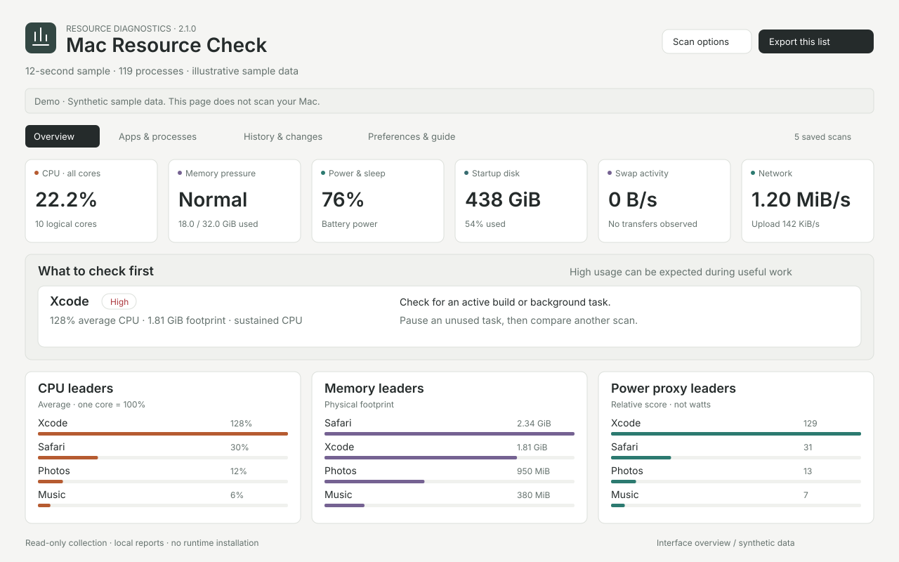

# Mac Resource Check

A local macOS resource scanner that turns process statistics into a sorted, interactive report. Find the apps using the most CPU or memory, inspect their helpers, and compare scans after making a change.

**macOS 12+ · Offline dashboard · No runtime installs · MIT license**



_Interface overview using illustrative sample data. The [interactive demo](docs/index.html) uses synthetic data and does not scan your computer. Download the repository and open that file in a browser, or view it through GitHub Pages._

## Get started

Download the user ZIP from this repository's Releases, unzip it, and double-click **Mac Resource Check.command**. A roughly 12-second scan opens the dashboard in your default browser. Reports are saved in **Reports** beside the launcher.

You can also download or clone the repository and run its included launcher:

```bash
bash "Mac Resource Check.command"
```

Double-click **Live Monitor.command** to repeat scans every 30 seconds. Press **Control-C in Terminal** to stop collection. Closing the browser or pausing page updates does not stop the scanner.

If macOS blocks a downloaded script, see [troubleshooting](docs/troubleshooting.md). No administrator password is required.

## What it shows

| View                | Use it for                                                                                 |
| ------------------- | ------------------------------------------------------------------------------------------ |
| Overview            | System CPU, memory pressure, swap activity, battery/sleep, network, disk, and leading apps |
| Apps & processes    | Search, sort, pin, filter, and inspect app groups or individual processes                  |
| History & changes   | Compare with a previous scan, find increases, or import a saved baseline                   |
| Preferences & guide | Adjust review thresholds, change the theme, and export or print reports                    |

App inspection includes average/peak CPU, footprint and RSS, short-term trends, helper trees, process states, running time, and sleep assertions. Suggestions favor small, reversible changes such as pausing a task or closing unused tabs. The scanner does not quit apps or change system settings.

The HTML report is self-contained. It loads no scripts, fonts, or analytics from the internet. Filters and preferences work without a server; saved browser preferences depend on local-file storage support.

## Usage

```bash
# Short snapshot
bash "Mac Resource Check.command" --quick

# Longer observation, repeated once per minute
bash "Mac Resource Check.command" --seconds 30 --watch 60

# Choose a browser and report folder
bash "Mac Resource Check.command" --browser safari --output "$HOME/Desktop/Mac Reports"

# Save reports without opening a browser
bash "Mac Resource Check.command" --no-open
```

| Option                | Default / accepted values                                         |
| --------------------- | ----------------------------------------------------------------- |
| `--seconds N`         | 12; 2–120, rounded up to two-second intervals                     |
| `--watch N`           | Off; 10–3600, at least two seconds longer than the rounded sample |
| `--history N`         | 40; retain 1–120 scans                                            |
| `--output DIR`        | `Reports` beside the launcher                                     |
| `--browser NAME`      | `default`, `safari`, `chrome`, `firefox`, `edge`, or `brave`      |
| `--quick`             | Four-second sample                                                |
| `--open-only`         | Reopen an existing report without collecting data                 |
| `--no-open`           | Suppress automatic browser launch                                 |
| `--version`, `--help` | Show version or usage                                             |

The dashboard's **Scan options** builds a command with the report's paths. A static HTML page cannot start the native scanner itself. Reopening the script collects a new scan; refreshing the browser shows saved data.

## Reading the results

High usage can be normal during a build, call, backup, or video playback. Review flags are prompts to investigate, not diagnoses.

- **CPU:** Process CPU uses 100% per logical core; overall CPU uses 0–100% across the machine. The initial reading is discarded. Peaks are observed intervals, not instantaneous maxima.
- **Memory:** Footprint includes compressed allocations. RSS is a separate reading. Helper totals are approximate; use memory pressure and active swap for context.
- **Power:** The score is `top`'s CPU-and-idle-wakeup proxy. It is not watts or Activity Monitor's full Energy Impact.
- **I/O:** Network and disk rates describe interfaces/devices, rather than individual processes.

See [measurement details](docs/measurements.md) for calculations, grouping, priority thresholds, and limitations.

## Reports and privacy

Each report folder contains HTML, a full JSON snapshot, an app-group CSV, and a bounded history journal. History retains group-level measurements instead of every previous process snapshot. Report writes are atomic, and a folder lock prevents overlapping collectors from updating the same journal.

Process names, executable paths, and sleep assertion descriptions can reveal private context. Reports are ignored by Git and excluded from release archives. Check their contents before sharing. Raw network addresses and process command-line arguments are not exported. There is no upload or telemetry code.

## Development

End users need only macOS. Development uses **Node.js 22+** and **Python 3.9+**; Prettier is the only npm dependency and is used only for formatting.

```bash
npm ci
npm run demo       # Regenerate synthetic fixtures and build outputs
npm run check      # Formatting, behavior, build consistency, and package checks
npm run release    # User ZIP and SHA-256 checksum in artifacts/
```

Edit `src/`, then run `npm run build`. The two root launchers and `docs/index.html` are generated files and are checked against their sources in CI. Changes to demo generation or `VERSION` need `npm run demo`.

```text
src/                  Collector, parser, analysis rules, and dashboard
scripts/              Build, synthetic demo, validation, and release tools
tests/                Parser, dashboard behavior, and macOS launcher tests
docs/                 Measurements, architecture, troubleshooting, and demo
.github/              CI, draft release workflow, and contribution templates
```

See [architecture](docs/architecture.md) and [contributing](CONTRIBUTING.md) for implementation details.

## Compatibility and current limits

Live collection has been checked on macOS 27 on Apple silicon. macOS 12+ and Intel support are intended; the full hardware/version matrix has not been verified. Browser behavior is covered by isolated document-model tests, which do not verify browser layout. Manual Safari/Chrome rendering is still an outstanding release check.

This is a snapshot tool. It does not measure per-process GPU energy or establish that a process has a memory leak. Missing counters are shown as unavailable. App grouping depends on observable paths and parent relationships. Watch mode runs only while its Terminal process is active.

## License

[MIT](LICENSE). Contributions and bug reports are welcome. Please use synthetic examples or redact personal report data when opening an issue.
