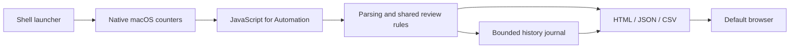

# Architecture

The application ships as two executable shell files and produces a self-contained HTML report. The source is split into small pieces for development; the build combines them so end users do not need Node, Python, a web server, or package installation.

## Collection

`src/launcher.sh` validates arguments, sets a controlled tool path and locale, creates a private temporary directory, and acquires a file lock for the destination report folder. macOS's `lockf` acquires a BSD file lock through a descriptor held by the shell; the OS releases it when the shell exits. The empty lock file remains in place to preserve a stable inode. Use a local report folder; network-share behavior is outside the tested scope.

`top` samples every two seconds. `ps` adds executable paths and process metadata. `vm_stat`, `netstat`, and `iostat` provide before/after counters; `sysctl`, `pmset`, and `df` provide system context. Optional collection failures become warnings. Failure to collect usable process samples stops the scan.

The launcher resolves the default HTTPS application through `NSWorkspace`, then opens the saved HTML with that browser. An explicit browser option uses its bundle ID. Safari is the fallback. Resolving an HTTPS handler does not make a network request.

## Parsing and analysis

`core.js` contains pure parsers and analysis functions. It discards the first CPU reading, rejects counter resets, preserves unavailable values, and groups helpers by outer app bundle or same-user parent relationships. It excludes the current collector's processes and keeps only processes present in the final reading.

`rules.js` is shared by collection and the dashboard. The saved JSON contains default review analysis; browser preferences can recalculate that analysis without changing measurements. Categories and suggestions are heuristic and are meant to support investigation.

`jxa.js` uses Foundation for atomic file writes and hardware context. History stores app-group summaries and a hardware/user signature. Invalid or incompatible history is backed up before starting or repairing a journal. Reports include neither raw network addresses nor process command-line arguments.

## Dashboard

`report.html`, `report.css`, and `report.js` form a static application. SVG graphs require no chart library. A restrictive content policy allows the embedded scripts/styles and blocks network connections. Text escaping protects HTML output, JSON embedding escapes markup delimiters, and CSV exports neutralize spreadsheet formulas in names.

The dashboard supports filtering, sorting, process inspection, preferences, imported baselines, and exports. Watch reports reload every ten seconds when no dialog or input is active. View state is saved before a reload. This refresh reads the saved report; it does not start a scanner.

## Build and distribution

`scripts/build.py` injects the version, shared rules, dashboard assets, and renderer into the launcher. `--check` fails when committed generated files do not match the source. `scripts/demo.cjs` creates deterministic synthetic inputs, processes them through the actual analysis code, and writes the public fixture.

`scripts/release.py` packages an explicit allowlist, normalizes archive timestamps and permissions, and writes a SHA-256 checksum. Collected reports cannot enter a release through a recursive directory copy. The repository's `.gitignore` independently excludes reports and development output.

## Tests and boundaries

Parser tests exercise sample handling, grouping, user boundaries, missing counters, wakeup resets, swap, and I/O. Dashboard tests use an isolated document model to cover state and behavior. macOS integration tests exercise the JXA renderer and launcher using synthetic process data and a mocked browser opener. They also check concurrent scans, lock cleanup, history repair, and exports.

These tests do not replace manual browser layout checks or validation across macOS versions and hardware. See the release checklist in [publishing](publishing.md).
